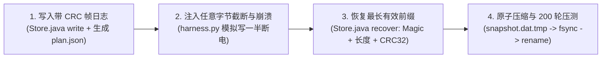

# crashsafe

[English](README.md) | [简体中文](README.zh-CN.md)

**用可复现实验证明：崩溃不会丢失任何已确认写入的数据。** `crashsafe` 是一个带测试平台（Harness）的微型日志结构键值存储，会在任意字节偏移处截断日志，并验证恢复结果是否严格等于截断前最后一个完整写入的记录集合——无半条残缺记录、无幽灵键、无静默丢数。

```console
$ python scripts/demo.py
crashsafe 0.1.0  500 records  24,472 bytes
truncation trials 60  failures 0
  crash before rename  keys 400   preserved True
  crash after rename   keys 400   preserved True
  clean compaction     keys 400   preserved True
stress 200 trials  mismatches 0  phantom 0
```

## 操作工作流与流程图



## 安全性论证

每条记录按 `magic(2) | length(4) | CRC32(4) | payload` 格式封装。恢复流程顺序扫描日志文件，只要遇到以下三类错误之一立即停止：魔数不匹配、长度越界超过文件末尾、或 CRC32 校验失败。随后将文件截断到最后一个有效偏移位置，避免后续追加落在残缺记录后面。

快照压缩时先写入 `snapshot.dat.tmp`、执行 `fsync`，再原子 `rename` 覆盖 `snapshot.dat`：重命名之前以日志为准，重命名之后以快照为准，剩余日志重放保持幂等。

## 实测结果

500 条记录（400 个不同键，共 24,472 字节日志）：

| 检查项 | 结果 |
| --- | --- |
| 随机字节偏移截断测试 | 60 次 |
| 恢复不一致次数 | 0 |
| 最大修复尾部残片 | 63 字节 |
| 压缩测试：rename 前崩溃 | 状态完整保留 |
| 压缩测试：rename 后崩溃 | 状态完整保留 |
| 随机压力测试（进程内） | 200 次，0 不一致，0 幽灵键 |

## 快速开始与分步工作流

```bash
# 一键运行完整崩溃恢复实验
python scripts/demo.py
```

手动分步运行：

```bash
javac -d out java/src/crashsafe/Store.java
java -cp out crashsafe.Store write --dir data/store --records 500 --seed 7 --plan data/plan.json
java -cp out crashsafe.Store recover --dir data/store --json data/state.json --dump data/dump.tsv
java -cp out crashsafe.Store compact --dir data/store --crash-before-rename
java -cp out crashsafe.Store stress --dir data/stress --trials 200 --records 300
```

## 建模边界与不建模的内容

- **已建模**：操作系统可能持久化日志的任意前缀（单文件日志最严苛的截断模型）。
- **未建模**：块内扇区撕裂、`fsync` 期间掉电、文件系统乱序重排或并发多写者。
- **非生产数据库**：无索引、无事务隔离、打开时全量读入内存；定位是恢复规则验证测试床。

## 仓库结构与开发测试

```
java/src/crashsafe/Store.java    记录帧编码、恢复、原子快照压缩
python/src/crashsafe/harness.py  截断与压缩故障注入测试台
python/src/crashsafe/report.py   Markdown 报告与指标输出
scripts/demo.py                  一键运行完整实验
```

```bash
PYTHONPATH=python/src python -m unittest discover -s python/tests -t python/tests -v
cd python && pip install -e ".[dev]" && ruff check . && mypy
```

## 开源协议

MIT，详见 [LICENSE](LICENSE)。
